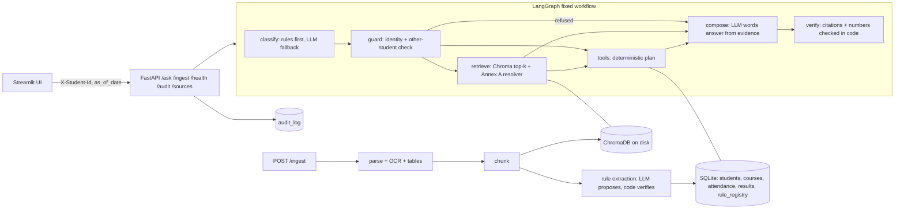

# Architecture

> Owner: Pratham (F21). Every member must be able to explain every box.

## Why this design (be ready to say these out loud)
| Decision | Why | Alternative we rejected |
| --- | --- | --- |
| One fixed workflow, no agents | Steps are known in advance; deterministic steps are testable and explainable | Supervisor + RAG/tool/rule agents: more LLM calls, more failure modes, no requirement needs it |
| Rules-first routing | Most questions are classifiable by keywords; cheaper and reproducible | LLM router on every call |
| Precedence in code | Annex A is an algorithm, not a judgement; judges test it with unseen docs | Asking the LLM which document wins |
| Thresholds only from rule_registry | R5; a new circular changes behaviour with no code change | Constants in tools |
| Citations built in code | The LLM never types a doc_id/page/date, so it cannot invent one | LLM-written citations |
| bge-small + section chunks | (fill with eval numbers) | MiniLM, fixed-size chunks |

## Assumptions and limitations
- (fill during the day)
